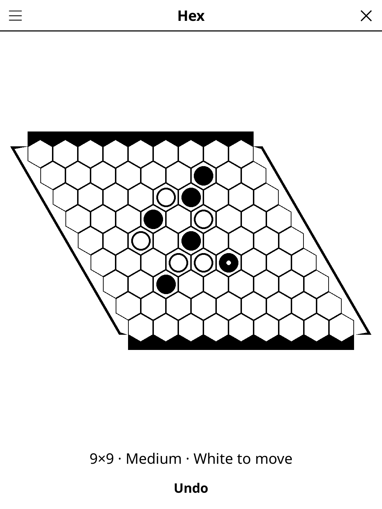

# hex.koplugin

A Hex plugin for [KOReader](https://github.com/koreader/koreader): connect your
two sides of a rhombus of hexagons, against the computer or a friend.

## Screenshot

## Rules

Two players take turns placing a stone on any empty cell. **Black** moves first
and tries to join the **top and bottom** edges (the solid black bands);
**White** tries to join the **left and right** edges (the hollow bands). Each
cell touches six others; an unbroken chain of your stones from one of your
edges to the other wins. There is no draw — a full board always has exactly
one connected player.

**Swap rule (optional).** Moving first is a big advantage. With the rule on,
White's first turn may be **Swap** instead of a stone: Black's opening stone
becomes a White stone, mirrored across the long diagonal, and Black moves
again. Black should therefore open with a move that is neither too strong nor
too weak.

## Features

- **7×7, 9×9 and 11×11** boards
- **1 player** against the computer, as Black or White — three levels
- **2 players** on the same device
- **Swap rule** on or off; a **Swap** button appears in the action bar when it is on
- **Undo** — against the computer, takes back its reply and your move together
- The winning chain is shaded once the game is won; the last stone carries a dot
- **Auto-save** — the game in progress is restored on the next launch

## The computer opponent

Monte Carlo tree search with RAVE (all-moves-as-first) statistics. A Hex
playout is simply "fill the board at random and see who connects" — a full
board always has one winner — and the playouts save bridges: when one cell of
a bridge is taken, the other is answered. Before searching, it takes a winning
cell if there is one and blocks the opponent's only winning cell.

| Level  | Playouts per move | Bridge-saving playouts |
|--------|------------------:|:----------------------:|
| Easy   | 300    | no  |
| Medium | 3 000  | yes |
| Hard   | 20 000 | yes |

Measured on 11×11 with two random opening stones per game, sides alternated:
hard beats medium 20-0, medium beats easy 20-0, easy beats a random player
20-0. Hard's slowest move took 0.44 s on a desktop Mac (LuaJIT), so expect a
few seconds on an e-ink reader. Each level also has a wall-clock cap (2 / 4 / 8 s) as a safety net on slow
devices.

An alpha-beta search on a two-distance evaluation (the classic Queenbee
approach) was measured against it and lost every game, even with more time
per move — see the CHANGELOG notes and `ai.lua`.

## Installation

1. Download `hex.koplugin.zip` from the [latest release](../../releases/latest).
2. Extract into the `plugins/` folder of your KOReader data directory.
3. Restart KOReader.
4. Open the menu → **Tools** → **Hex**.

## Controls

| Action | How |
|--------|-----|
| Place a stone | Tap an empty cell |
| Swap (swap rule on, White's first turn) | Tap **Swap** |
| Undo | Tap **Undo** |
| New game, size, difficulty, players, colour, swap rule, rules | Title-bar menu (☰) |

## License

GPL-3.0 — see [LICENSE](LICENSE).
